# APEXlangとAutonomous Databaseで習慣トラッカーを作る

## はじめに

毎日の読書や運動を記録する「習慣トラッカー」を題材に、APEXlangでOracle APEXアプリを作る流れを紹介します。
画面を作るだけでなく、データベースへの保存、集計、画面の見た目の調整までを確認します。

2026年11月19日に、アプリの取り込み、習慣登録、実施・取り消し、履歴表示まで実機で確認しました。
掲載する習慣と記録は、撮影用に作成した架空データです。
接続先と環境固有の識別子は、読者が置き換えられる値で説明します。

## 作るものと検証の目的

アプリ名は「Habit Pulse」です。
次の操作を、ブラウザーから行えるようにします。

- 習慣の追加、編集、停止
- 今日の習慣の実施記録と取り消し
- 過去の記録の確認
- 過去7日間の達成率の確認

成功とする条件は、登録した記録が再読み込み後も残ること、ログインした利用者のデータが分離されること、集計値が記録内容と一致することです。
見た目だけを作るのではなく、保存と集計までつながることを確認します。

## 構成を確認する

APEXlangは、APEXの画面や設定をテキストで表すための言語です。
SQLclは、データベース接続やAPEXlangの検証・取り込みに使うOracleのコマンドラインツールです。
ADBはAutonomous Databaseの略で、この記事ではアプリの実行環境とデータ保存先として利用します。

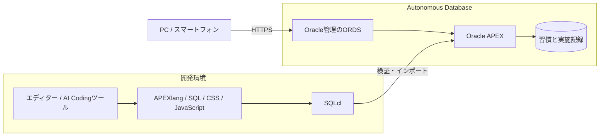

APEXlangを使った開発では、SQLclでファイルを検証し、接続先のAPEXに取り込みます。
詳しくは[SQLclのAPEXlangコマンド](https://docs.oracle.com/en/database/oracle/sql-developer-command-line/26.1/sqcug/apexlang.html)を参照してください。

## 事前準備

### 必要なもの

Oracleの[APEXlang導入案内](https://www.oracle.com/apex/ai-application-generator/)では、APEX 26.1とSQLcl 26.1.2以降が案内されています。
古いAPEX環境を使い回す場合は、最初にAPEXのバージョンを確認してください。
最終確認時の実行環境は、APEX 26.1.6、SQLcl 26.3.1.0（Build 26.3.1.301.1413）、Java 21.0.13.1 LTSです。
検証日は2026年11月19日です。

| 項目 | 用途 | 確認状態 |
|---|---|---|
| ADB | APEX実行とデータ保存 | 起動と接続を確認 |
| APEXワークスペース | アプリ作成・管理 | 既存環境を利用 |
| ワークスペースに関連付けたスキーマ | SQLclの接続先とテーブル所有者 | テーブル・APIの作成と呼び出しを確認 |
| Java 21.0.13.1 LTS | SQLclの実行 | 最終確認済み |
| SQLcl 26.3.1.0 / Build 26.3.1.301.1413 | APEXlangの検証と取り込み | 最終確認済み |

作成済みのADBとAPEXワークスペースを利用できます。
新しくワークスペースを作る場合は、ADBのAPEX管理画面から「Create Workspace」を開き、データベースユーザーとワークスペース名を指定します。
ADMINユーザーはワークスペースに関連付けられないため、アプリ用のスキーマを使用します。
詳しい画面手順は[ADBのAPEXワークスペース作成手順](https://docs.oracle.com/en-us/iaas/autonomous-database-serverless/doc/apex-create-workspace.html)を参照してください。

### 1. ADBを用意する

今回の検証では停止していた既存のADBを起動して利用しました。
すでにADBを持っている場合は、新規作成せず、そのデータベースの詳細画面で状態を確認してください。
「Stopped」の場合は「Start」を実行し、「Available」になるまで待ちます。

ADBを初めて作る場合の操作は次のとおりです。
こちらは既存環境を持たない読者向けの準備手順であり、今回新規作成を実施したという意味ではありません。

1. OCIコンソールにサインインし、利用するリージョンを選びます。
2. 「Oracle Database」から「Autonomous AI Database」を開きます。
3. 利用権限のあるコンパートメントを選び、「Create Autonomous Database」を開きます。
4. 表示名とデータベース名を入力します。
5. ServerlessとTransaction Processingを選び、検証用途に必要なCPU・ストレージを指定します。
6. ADMINのパスワードを設定します。
7. 接続元に合わせてネットワークアクセスを設定し、作成します。
8. 状態が「Available」になるまで待ちます。

接続元を制限する構成の場合は、SQLclを実行する端末または作業サーバーからのアクセスを許可してください。
プライベート・エンドポイントを使う場合は、そのVCNへ到達できる環境からSQLclを実行します。
リソースの選択肢と項目名は環境により異なるため、[ADBの公式作成手順](https://docs.oracle.com/en-us/iaas/autonomous-database-serverless/doc/autonomous-provision.html)も確認してください。

### 2. APEXワークスペースとスキーマを用意する

ワークスペースはAPEXアプリを管理する作業領域です。
スキーマは、アプリが利用するテーブルなどを所有するデータベースユーザーです。
この2つは役割が異なり、SQLclではワークスペース名ではなくスキーマのユーザー名で接続します。
DDLの接続先と、APEXアプリのParsing Schema（解析スキーマ）は、必ず同じDBユーザーにします。
ADMINでテーブルを作成して別の解析スキーマから実行すると、画面からテーブルやAPIを参照できません。

1. OCIコンソールでADBの詳細画面を開きます。
2. 「Tools」からOracle APEXを開きます。
3. 管理画面にADMINの資格情報でサインインします。
4. 「Create Workspace」を開きます。
5. 新規スキーマを作る場合は、Database Userに公開用例として`HABIT_APP`を指定し、パスワードを設定します。
6. Workspace Nameに公開用例として`HABIT_WORKSPACE`を指定し、作成します。
7. 作成したワークスペースへ入り、App Builderを開けることを確認します。
8. 次の手順で、アプリの動作確認に使うAPEXユーザーを用意します。

APEX Accounts認証を使用するため、アプリに入る利用者もワークスペース内で管理します。
既存の利用者がいる場合は、そのアカウントを利用できます。
新しく追加する場合は、ワークスペース管理者で次を操作します。

1. ワークスペース右上の管理メニューを開き、「Administration」→「Manage Users and Groups」を選びます。
2. 「Create User」を開きます。
3. Username、Email、Password、Confirm Passwordを入力します。
4. Account Privilegesで「User is a developer」と「User is a workspace administrator」をともにNoにし、アプリだけを利用するEnd Userにします。
5. アカウントをロックしない設定にし、パスワード変更を初回に要求するかを運用に合わせて指定します。
6. 「Create User」で保存します。
7. アプリの取り込み後、このユーザー名とパスワードでアプリへサインインします。

このAPEXユーザーは、SQLclで接続する`HABIT_APP`とは別です。
画面上の項目名はAPEXの表示言語で異なるため、日本語表示では「ユーザーおよびグループの管理」「ユーザーの作成」に相当する項目を選びます。

`HABIT_APP`と`HABIT_WORKSPACE`は記事用の例です。
APEXへのサインイン用ユーザー、DBスキーマのパスワード、Walletのパスワードを混同しないようにしてください。
既存スキーマを選んだ場合は、テーブル作成など、本アプリが必要とする権限も確認します。
[ADBのワークスペース作成手順](https://docs.oracle.com/en-us/iaas/autonomous-database-serverless/doc/apex-create-workspace.html)

### 3. JavaとSQLclをインストールする

1. Java 17または21をインストールします。
2. [Oracle SQLclのダウンロードページ](https://www.oracle.com/database/sqldeveloper/technologies/sqlcl/download/)からSQLclを取得します。
3. ZIPを任意のディレクトリへ展開します。
4. 展開先の`bin`ディレクトリをPATHに追加します。
5. 新しい端末を開き、次のバージョン確認を行います。

作業サーバーを使う場合も、SQLclを実行するそのサーバーへインストールします。
自分のPCからADBへ接続できる場合は、別の作業サーバーを用意する必要はありません。

WindowsでPowerShellを使う場合、次のように展開できます。
あらかじめJava 21のJDKをインストールし、そのインストール先を確認しておきます。
`jdk-21`の部分とSQLclのZIP名は、取得した実際の名前へ置き換えてください。

```powershell
New-Item -ItemType Directory -Path C:\tools -Force
Expand-Archive -LiteralPath "$env:USERPROFILE\Downloads\sqlcl-<バージョン>.zip" -DestinationPath C:\tools
$env:JAVA_HOME = 'C:\Program Files\Java\jdk-21'
$env:Path = "$env:JAVA_HOME\bin;C:\tools\sqlcl\bin;$env:Path"
```

この`$env:`の設定は、実行中のPowerShellだけに適用されます。
別の端末を開いた場合は再設定するか、Windowsの「環境変数を編集」画面でユーザー環境変数`JAVA_HOME`と`Path`へ同じ値を登録してください。
ZIPの展開結果によってフォルダー名が異なる場合は、`sql.exe`またはSQLclの起動ファイルがある`bin`へPathを合わせます。

### 4. バージョンを確認する

端末で次を実行します。

```text
java -version
sql -version
```

APEXのバージョンは、後述するWalletと保存接続の準備後にSQLで確認します。
先にSQLclをインストールしただけの状態では、データベースへSQLを実行できません。

### 5. 接続用Walletをダウンロードする

この記事では、Walletを使うmTLS接続で準備手順を説明します。
Walletは安全な接続に必要な証明書などをまとめたファイルです。

1. OCIコンソールで対象ADBの詳細画面を開きます。
2. 「Database connection」を開きます。
3. Wallet typeに「Instance wallet」を選びます。
4. 「Download wallet」を押します。
5. ダウンロードするWalletを保護するパスワードを設定します。
6. ZIPファイルを、公開リポジトリの外に保存します。

以下では、このファイルを`Wallet_habitdb.zip`、保存先を`C:/secure/Wallet_habitdb.zip`と表記します。
Linuxの場合は、同じ箇所を自分の保存先へ置き換えます。
Walletのパスワードはダウンロードファイルの保護用であり、スキーマへ接続するためのパスワードとは別です。
[Walletの公式ダウンロード手順](https://docs.oracle.com/en-us/iaas/autonomous-database-serverless/doc/connect-download-wallet.html)

### 6. SQLclの保存接続を作る

SQLclを未接続で起動します。

```text
sql /nolog
```

`SQL>`プロンプトでWalletを指定します。

```text
set cloudconfig C:/secure/Wallet_habitdb.zip
```

Wallet内の`tnsnames.ora`には接続サービス名が記載されています。
自分のWalletにある、たとえば`habitdb_low`に相当する名前を確認します。
ZIPはWallet指定のために展開する必要はありませんが、サービス名の確認用に中身を閲覧します。

次のコマンドで、スキーマへの接続を`habit-dev`という名前で保存します。
`habitdb_low`と`HABIT_APP`は自分の値へ置き換えてください。

```text
connect -save habit-dev -savepwd -cloudconfig C:/secure/Wallet_habitdb.zip HABIT_APP@habitdb_low
```

パスワードの入力を求められたら、HABIT_APPのデータベースパスワードを入力します。
パスワードをコマンド本文へ記載しません。
`-savepwd`はSQLclの接続ストアにパスワードを保存する指定です。
この保存領域やWalletをGitへ追加しないでください。

保存と接続先を確認します。

```text
connmgr list
show user
select version_no from apex_release;
exit
```

以後は端末から、保存した接続名を指定して起動できます。

```text
sql -name habit-dev
```

`show user`で対象スキーマが表示されれば、後続のDDLとAPEXlangの取り込みに進めます。
APEX App Builderでアプリの定義・プロパティに表示されるParsing Schemaも確認し、同じユーザーであることを確かめてください。
この記事の例では、SQLclの接続ユーザー、DDLの所有者、Parsing Schema、インポートの`-schema`をすべて`HABIT_APP`へそろえます。
上記の`select version_no from apex_release;`でAPEXlang非対応のバージョンが返った場合は、対応環境を準備してから進めてください。
Wallet接続の基本操作は[SQLclのmTLS接続手順](https://docs.oracle.com/en-us/iaas/autonomous-database-serverless/doc/connect-sqlcl.html)、保存接続は[SQLcl Quick Start](https://docs.oracle.com/en/database/oracle/sql-developer-command-line/26.3/sqcug/quick-start.html)を参照してください。

### 7. APEXlang用スキルを準備する

AI Codingツールを使う場合は、SQLclを未接続で起動してスキルの同期を実行します。

```text
sql /nolog
skills sync
exit
```

この操作はOracleのスキルを取得するための準備です。
習慣トラッカーのソース一式があれば、AI Codingツールを使わない読者も、後述するSQLclの検証とインポートを実行できます。
[OracleのAPEXlang導入案内](https://www.oracle.com/apex/ai-application-generator/)

## データと画面を設計する

本アプリでは、習慣の定義と日々の実施記録を分けます。
「読書をする」という設定と「11月19日に実施した」という記録を別々に持つことで、習慣名の変更や日付ごとの集計がしやすくなります。

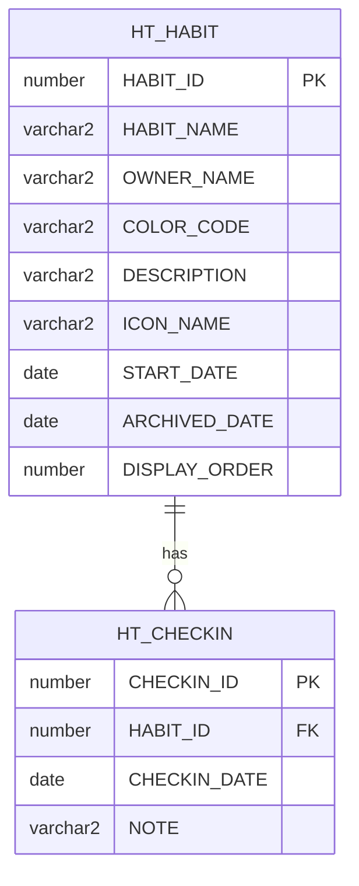

図は主要な列を示しています。
両テーブルには、図の項目に加えて作成日時、習慣テーブルには更新日時も保持します。
主キーのIDは、Oracle DatabaseのIDENTITY列によって自動生成します。

| テーブル | 保存する内容 | 主な制約 |
|---|---|---|
| HT_HABIT | 習慣名、説明、所有者、表示色、アイコン、開始日、アーカイブ日、表示順 | 習慣名は空白のみ不可、色とアイコンは許可値に限定 |
| HT_CHECKIN | 習慣ID、実施日、メモ | 習慣IDと実施日の組み合わせは一意、日付に時刻を含めない |

実施したかどうかは、HT_CHECKINにその日の行が存在するかで判断します。
取り消した場合はその行を削除するので、状態フラグと実施記録の不一致を避けられます。

同じ習慣を同じ日に二度記録しないため、データベースにも次の一意制約を設けています。

```sql
constraint ht_checkin_day_uk unique(habit_id,checkin_date)
```

「今日」は常に日本標準時で計算します。
端末やデータベースのタイムゾーン設定が異なっても、基準日が変わらないようにしています。

```sql
trunc(cast(systimestamp at time zone 'Asia/Tokyo' as date))
```

更新操作は、PL/SQLパッケージの`HT_API`にまとめています。
PL/SQLパッケージは、関連する処理をまとめたデータベース側のプログラムです。

| 処理 | 用途 |
|---|---|
| today | JSTの今日を返す |
| owner_name | APEXのAPP_USERからログイン利用者を取得する |
| save_habit | 習慣を追加・編集する |
| record_today | 今日の実施を登録する |
| undo_today | 今日の実施を取り消す |
| archive_habit | 習慣をアーカイブする |

`OWNER_NAME`には、画面入力値ではなくAPEXの認証済みセッションにある`APP_USER`を大文字へ正規化して保存します。
編集や実施登録の前にも所有者を確認し、他の利用者が所有する習慣IDでは更新できないようにします。
同じ実施登録を再送した場合は`MERGE`で既存のメモを更新し、行数が増えないようにします。

習慣をやめるときはアーカイブし、過去の記録は残します。
アーカイブした日以降は「今日」の対象から外し、実施登録も受け付けません。

実装した画面定義は「今日」「振り返り」「習慣管理」「履歴」と、登録・編集用の詳細画面です。
各画面から登録、実施、取り消し、アーカイブ、履歴の確認まで実行しました。

初版には次の制限があります。

- 連続達成日数とカレンダーヒートマップは未実装
- 習慣管理では現役とアーカイブ済みを同じ一覧へ表示し、状態ラベルで区別
- 色の選択値は保存するが、カードのデザインは深緑で統一
- 習慣別の累積実施数グラフは未実装

デザイン案と初版の実装範囲を分け、ここから段階的に改善します。

## APEXlangで実装する

### 1. テーブルとAPIを作成する

まず記事と添付ソース一式を、PCまたは作業サーバーの任意の作業用フォルダーへ配置します。
`article.md`と同じ階層に`scripts`と`applications`がある構成を保ち、端末のカレントディレクトリをそのフォルダーに合わせてください。
ソースと画像は[検証済みのスナップショット](https://github.com/nomukyounomukyou-gh/qiita/tree/b0cd64b905fefcc95299b73489e028d4803d2cdb/articles/apexlang-habit-tracker)で公開しています。
Gitが入っていない場合は、[Git公式サイト](https://git-scm.com/downloads)から使用するOSのインストーラーを取得して導入し、新しい端末で`git --version`が実行できることを確認します。
端末で次の順に実行すると、検証したファイルを同じ状態で取得できます。
チェックアウトする値はコミットIDで、後日のソース変更に影響されず追試するために固定しています。

```text
git clone --filter=blob:none https://github.com/nomukyounomukyou-gh/qiita.git qiita-habit-sample
cd qiita-habit-sample
git checkout b0cd64b905fefcc95299b73489e028d4803d2cdb
cd articles/apexlang-habit-tracker
```

このフォルダーで、後述するSQLclのコマンドを実行します。

長いDDLは記事へ分割して貼り付けず、[scripts/01_schema.sql](https://github.com/nomukyounomukyou-gh/qiita/blob/b0cd64b905fefcc95299b73489e028d4803d2cdb/articles/apexlang-habit-tracker/scripts/01_schema.sql)にまとめています。
このファイルに2つのテーブル、制約、索引、`HT_API`の定義と本体が入っています。
実行前に`show user`で、アプリのParsing Schemaと同じDBユーザーへ接続していることを確認します。
アプリ専用の空のスキーマで一度だけ実行してください。
同名のテーブルが存在するスキーマでの上書きや削除は行いません。

ダウンロードした記事用ディレクトリを端末で開き、次を実行します。
`habit-dev`は事前準備で保存したSQLclの接続名です。

```text
sql -name habit-dev
```

SQLclの`SQL>`プロンプトで実行します。

```text
@scripts/01_schema.sql
```

続けて、作成したオブジェクトの状態を確認します。

```sql
select object_name, object_type, status
from user_objects
where object_name in ('HT_HABIT', 'HT_CHECKIN', 'HT_API')
order by object_name, object_type;

select name, type, line, position, text
from user_errors
where name = 'HT_API'
order by sequence;
```

テーブルとパッケージの状態が`VALID`で、`USER_ERRORS`の結果が0件なら、データベース側の準備は完了です。

### 2. 要件をAIへ伝えてAPEXlangを生成する

添付アプリをそのまま試す場合は、次節の検証へ進めます。
自分で作成する場合は、前節で作成したDDLと[requirements.md](requirements.md)をAI Codingツールへ渡し、作る画面と保存処理を指定します。
次は、この記事の初版を再作成するための指示例です。
実際に入力した会話の引用ではありません。

```text
APEXlangで習慣トラッカー「Habit Pulse」を作成してください。
添付のrequirements.mdとscripts/01_schema.sqlを参照し、
以下の初版機能に絞って実装してください。

画面：今日、振り返り、習慣管理、履歴、習慣の登録・詳細、ログイン。
今日には対象数・実施数・達成率と、現役習慣のカードを表示。
カードのリンクから詳細画面を開き、習慣保存、今日のメモ付き実施登録、
実施取り消し、アーカイブを行います。
振り返りには今日を含む7日間の達成率の折れ線グラフを表示し、
横軸・縦軸・系列名に意味の分かる日本語を付けてください。
履歴は実施日・習慣名・メモの読取専用レポートにしてください。

既存のHT_HABIT、HT_CHECKIN、HT_APIを使用します。
一覧・集計はAPP_USERで所有者を絞り込み、更新はHT_APIを呼び出します。
認証はAPEX Accounts、日付はJSTを使用してください。
白と深緑を基調とした、PCとスマートフォンで使える画面にしてください。
初版では連続日数、ヒートマップ、通知は作成しません。

出力先はapplications/habit-pulseとしてください。
接続先ワークスペース名と解析スキーマは明示した値を使用し、
DDLの実行先と解析スキーマを一致させてください。
生成後はAPEXlangを検証し、成功するまでエラーを修正してください。
```

指示を短くするだけでなく、テーブル名とAPI、利用者ごとの絞り込み、初版で作る範囲を具体的に伝えることがポイントです。
ワークスペース名や保存接続名は、自分の環境の値をAIへ別途伝えます。
パスワードやWalletそのものを指示文へ貼り付ける必要はありません。

今回のソースは、次の構成になりました。

```text
applications/habit-pulse/
├─ .apex/apexlang.json
├─ application.apx
├─ deployments/default.json
├─ pages/
│  ├─ p00001-today.apx
│  ├─ p00002-dashboard.apx
│  ├─ p00003-habits.apx
│  ├─ p00004-history.apx
│  ├─ p00010-habit.apx
│  └─ p09999-login.apx
├─ shared-components/
└─ supporting-objects/
```

`.apx`はAPEXのページや部品を記述するファイルです。
`application.apx`がアプリ全体、`pages`が個別画面、`shared-components`が認証やメニューなどの共通設定を担当します。
`.apex/apexlang.json`はコンパイラが使用するメタデータのバージョン情報で、独断で書き換えず、生成・エクスポートされた内容を保持します。
`deployments/default.json`は取り込み先の設定で、次節で自分の環境へ合わせます。

### 3. 生成されたコードを読む

APEXlangは、画面の部品と設定を宣言するためのDSL（特定の目的のための言語）です。
今回のアプリでは、APEX標準のCardsやChartを使用しています。
カードの内容はSQLで取得し、保存操作はPL/SQL、見た目の調整はCSSで記述します。

以下は、実機で検証・取り込みに成功したソースからの部分抜粋です。
説明用に一部だけを取り出しているため、各コード片を単体でインポートすることはできません。
実行には添付したアプリ全体を使用してください。

たとえば、「今日」のページでは、次の宣言でカード領域を定義しています。

```text
    region habits (
        name: "今日の習慣"
        type: cards
```

同じ領域内の次の設定が、SQLの取得列とカードの表示内容を対応させます。
`HABIT_NAME`をタイトル、`STATUS_LABEL`を実施状態、`DESCRIPTION`を説明文に使います。

```text
        title {
            column: HABIT_NAME
        }
        subtitle {
            column: STATUS_LABEL
        }
        body {
            column: DESCRIPTION
        }
```

「振り返り」のグラフは`chart`の`type: line`で折れ線を指定します。
SQLで集計した`LABEL`と`VALUE`を、次の設定で横軸のラベルと値へ割り当てます。

```text
            columnMapping {
                label: LABEL
                value: VALUE
            }
```

一方、詳細画面の保存処理は次の定義です。
`whenButtonPressed: @SAVE`が保存ボタンとの関連を示し、入力値を`HT_API.SAVE_HABIT`へ渡しています。
`:P10_NAME`などは、APEXが管理するページ項目の値を参照するバインド変数です。

````text
    process save (
        name: save
        type: executeCode
        execution {
            sequence: 10
            point: processing
        }
        source {
            location: localDatabase
            language: plsql
            plsqlCode:
            ```plsql
            begin ht_api.save_habit(:P10_ID,:P10_NAME,:P10_DESCRIPTION,:P10_COLOR,:P10_ICON,:P10_ORDER); end;
            ```
        }
        serverSideCondition {
            whenButtonPressed: @SAVE
        }
    )
````

このように、APEXlangの宣言が「どの画面部品を使うか」「いつ何を呼び出すか」を決め、`HT_API`が所有者確認や保存を担当します。
配色・余白・カードの角丸などは、ページの`css`に指定したCSSで調整しました。
CSSを変更しても、テーブルやAPIの定義を作り直す必要はありません。

### 4. APEXlangの画面を検証・取り込みする

APEXlangソースは`applications/habit-pulse`に配置しています。
ページ定義、認証、ナビゲーション、テーマなどを含むアプリ全体を、このディレクトリで管理します。

まず、`applications/habit-pulse/deployments/default.json`をテキストエディターで開きます。
`HABIT_WORKSPACE`を取り込み先の実際のワークスペース名、`HABIT_APP`をテーブルを作成した解析スキーマ名へ変更します。

```json
{
  "app": {
    "databaseSession": {
      "parsingSchema": "HABIT_APP"
    }
  },
  "workspace": {
    "name": "HABIT_WORKSPACE"
  }
}
```

記事用ディレクトリで起動したSQLclから、対象スキーマに接続した状態で検証します。
コマンドの`HABIT_WORKSPACE`も、自分の値に置き換えます。

```text
apex validate -input applications/habit-pulse -workspace HABIT_WORKSPACE
```

実機では警告のない`Validation successful`を確認しました。
エラーが表示された場合は、ファイル名・行番号・内容を確認し、修正して再検証します。
今回も、ひな形の属性が実機のコンパイラと合わない箇所を修正しました。
たとえばログイン用プロセスの種類を`executeCode`へ合わせ、隠し項目の保護設定を`checksumRequiredSessionLevel`へ修正しています。
エラーが出たまま先へ進めず、`apex validate`→修正→再検証の順に繰り返します。

次に、取り込み先で未使用のアプリケーションIDを確認します。
ワークスペースのApp Builderで既存アプリの一覧を開き、IDが重複しない値を選んでください。
今回の検証では110を使用しました。
既存アプリのIDを指定すると更新対象となるため、読者の環境ですでに110が使われている場合は別のIDに置き換えます。

```text
apex import -input applications/habit-pulse -workspace HABIT_WORKSPACE -schema HABIT_APP -id 110
```

`HABIT_APP`も、SQLclで接続しているアプリ用スキーマ名へ置き換えます。
実機では`Import successful`を確認し、アプリ110の名前がHabit Pulse、別名がHABIT-PULSEであることを確認しました。

### 5. アプリを開く

1. ブラウザーでAPEXワークスペースにサインインします。
2. App Builderを開きます。
3. 取り込んだIDの「Habit Pulse」を選びます。
4. 「Run Application」を押します。
5. ログイン画面で、事前準備で作成したAPEXユーザーの資格情報を入力します。

実機では専用のEnd Userを用意してログインし、以降の操作を確認しました。
認証方式はAPEX Accountsを使用しています。

## 完成画面と操作結果

### ログイン画面

取り込んだアプリを実行すると、次のログイン画面が表示されました。
ブラウザーのアドレスバーは掲載範囲から除外しています。

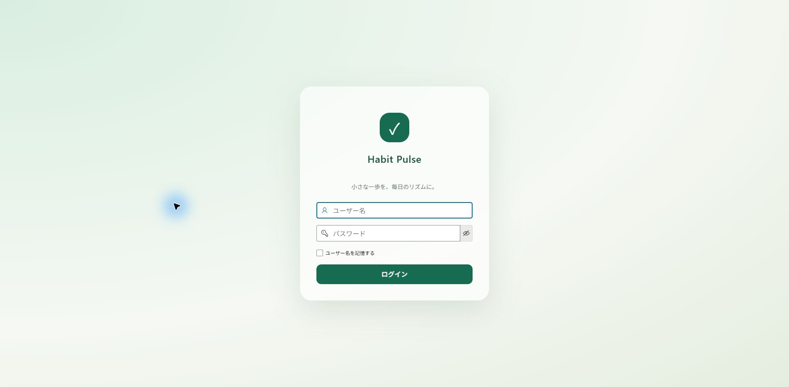

### 習慣を登録する

初回ログイン時は、習慣がまだありません。
「今日」の画面から追加操作を行います。

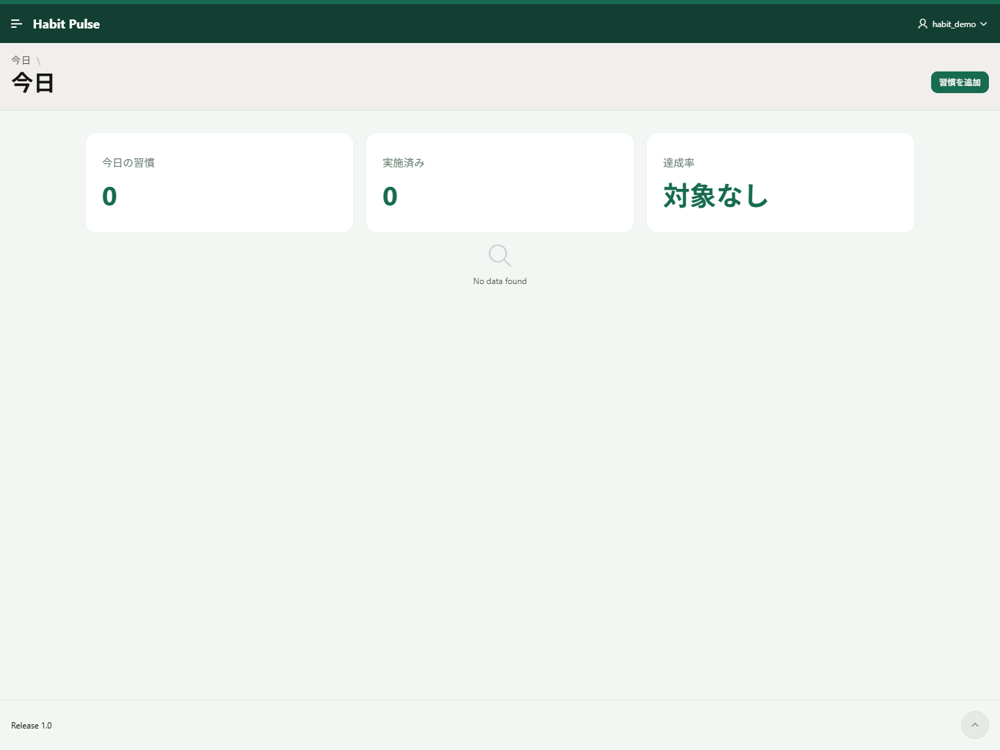

1. 習慣の追加画面を開きます。
2. 習慣名に「朝の読書」、説明に「朝食のあとに、好きな本を20分読む。」と入力します。
3. 表示色、アイコン、表示順を指定します。
4. 「保存」を押します。

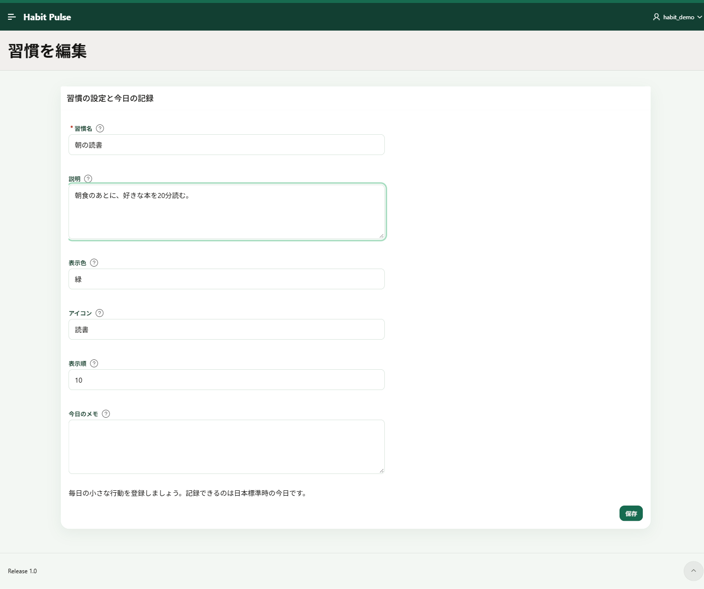

保存すると一覧にカードが追加されます。
この時点では「習慣を作成した」だけなので、今日の実施数はまだ0件です。

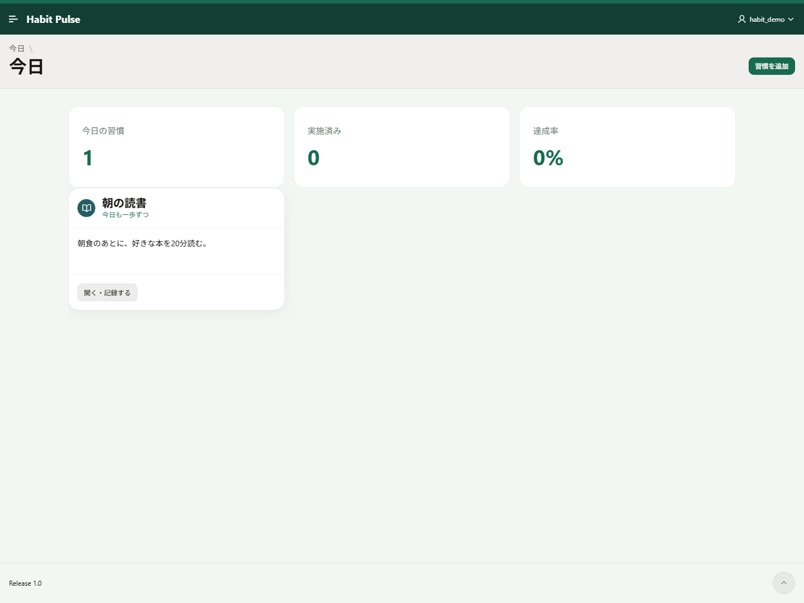

入力チェックも確認しました。
習慣名を空にして「保存」を押すと、保存されずに画面右上と項目の下にエラーが表示されます。
画像の`習慣名 must have some value.`はAPEXの既定メッセージで、「習慣名を入力してください」という意味です。

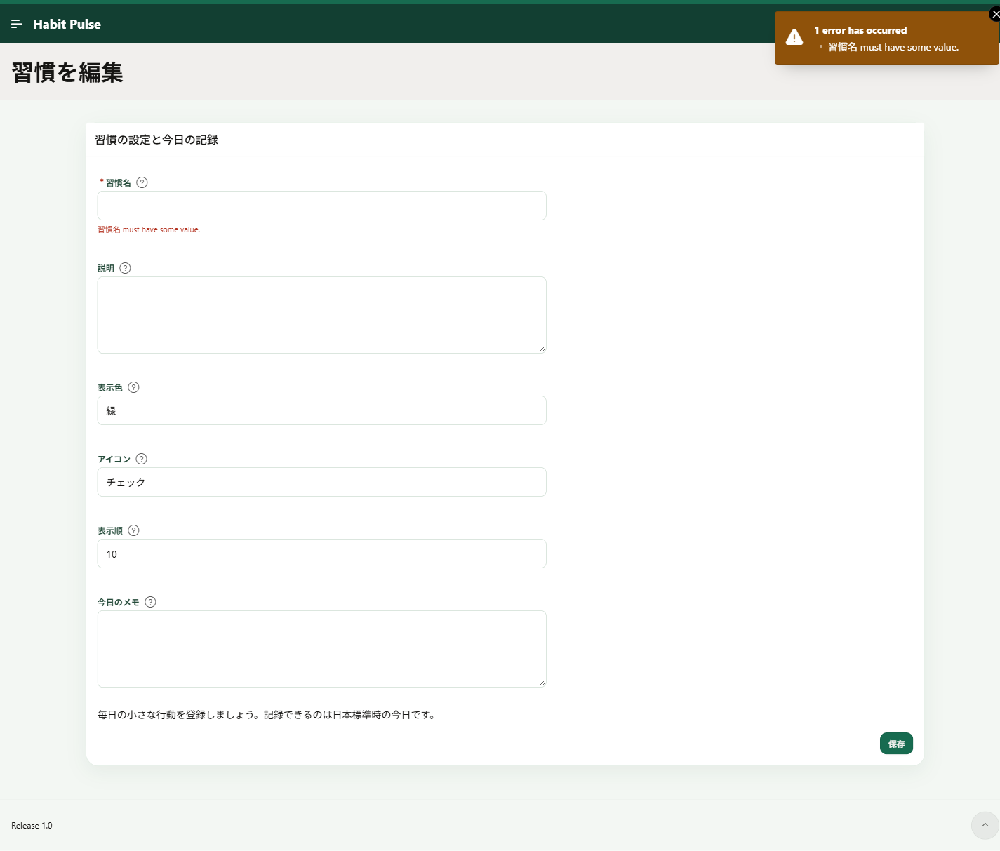

### 今日の実施を記録・取り消しする

カードの「開く・記録する」を押すと、設定と今日の記録を編集できます。
「今日のメモ」に内容を入力し、「今日の実施を記録」を押します。

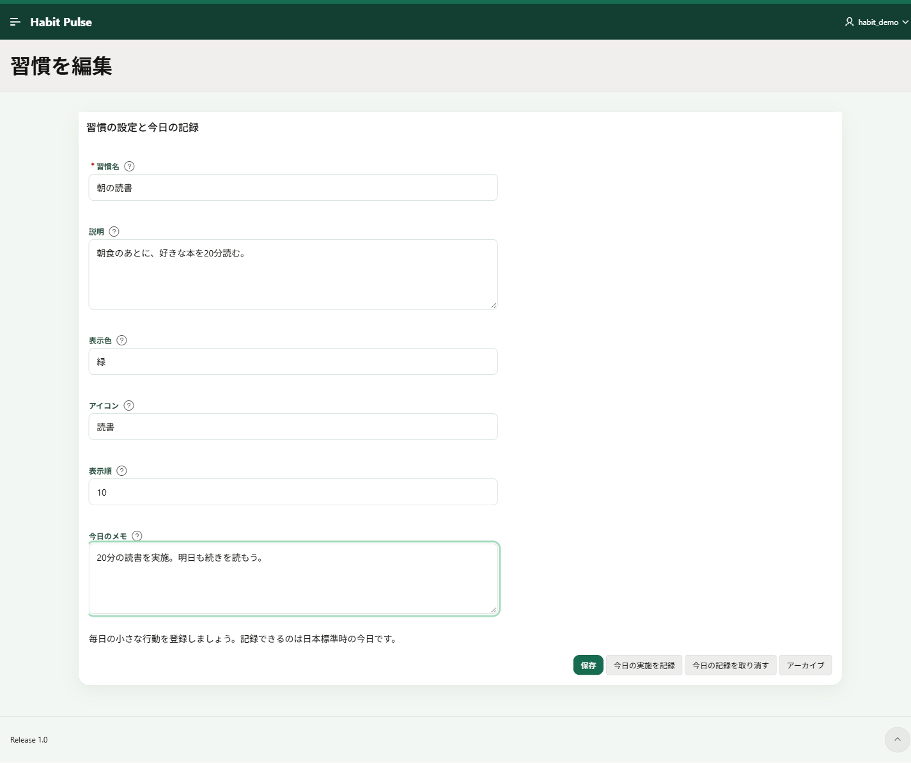

1件中1件を実施したので、今日の達成率は100%になりました。
ブラウザーで再読み込みしても実施済み状態が保持されることを確認しました。

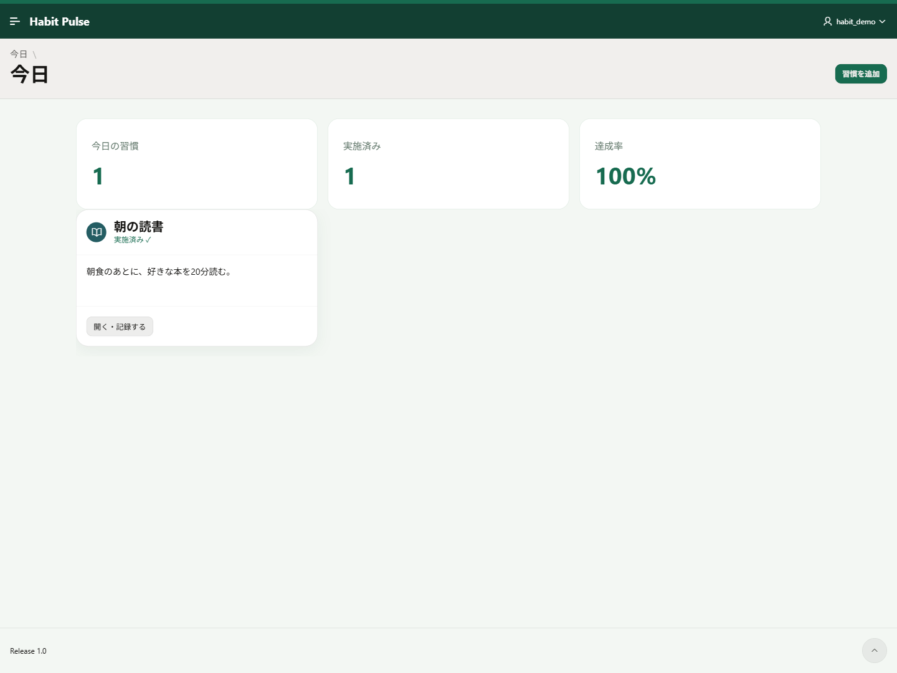

同じ詳細画面の「今日の記録を取り消す」を押すと、実施記録が削除され、達成率が0%へ戻ります。


アーカイブも詳細画面から行います。
再び実施を記録してからアーカイブしたところ、「今日」の対象から外れ、実施履歴は残りました。
アーカイブ済みの習慣は「習慣管理」から確認できます。

### 架空データを投入して集計を見る

実際の継続記録がなくても集計画面を試せるよう、[scripts/02_demo_data.sql](https://github.com/nomukyounomukyou-gh/qiita/blob/b0cd64b905fefcc95299b73489e028d4803d2cdb/articles/apexlang-habit-tracker/scripts/02_demo_data.sql)を用意しました。
3つの現役習慣に対し、今日を含む14日間の架空の実施記録を作成します。
本番の実績として使わず、専用のデモ利用者で試してください。

SQLclで解析スキーマに接続し、記事用ディレクトリから次を実行します。
`HABIT_DEMO`はAPEXに作成したログインユーザー名であり、SQLclの接続ユーザー名ではありません。

```text
@scripts/02_demo_data.sql HABIT_DEMO
```

同名のデモ習慣がすでにある場合はエラーで停止し、二重投入しません。
スクリプトは最後に`COMMIT`するため、デモ記録は接続終了後も残ります。

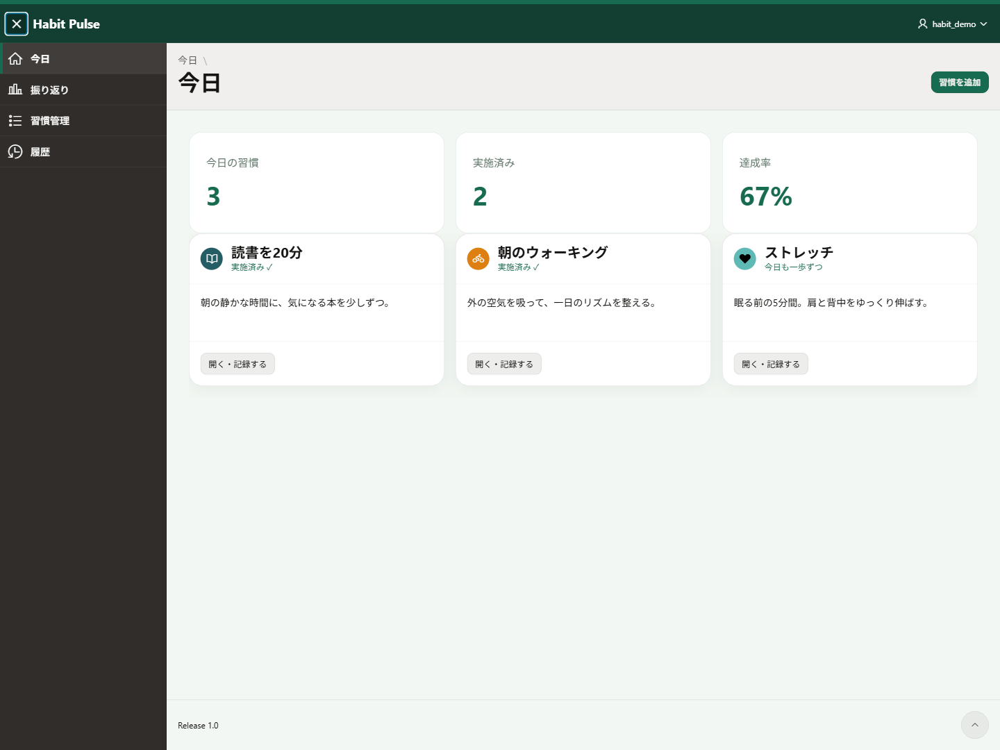

現役の習慣は3件、そのうち今日の実施は2件です。
「今日」の達成率は整数に四捨五入し、`2 ÷ 3 × 100 = 67%`と表示します。

「振り返り」では、今日を含む直近7日間の達成率を折れ線グラフで表示します。
横軸はJSTの日付、縦軸と系列名は「達成率（%）」です。
グラフの値は小数第1位までに丸めるため、同じ2件／3件でも66.7%となります。

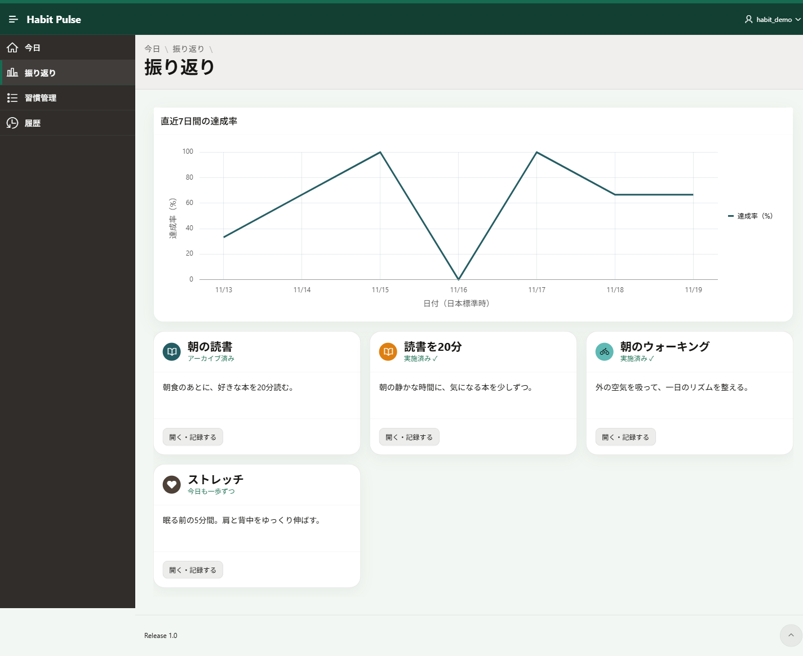

日ごとの分母は、その日に開始済みで、まだアーカイブしていない習慣の数です。
対象習慣が0件の日は0%とはせず、集計値をNULLとして扱います。
「今日」のKPIでは、分母が0の場合は「対象なし」と表示します。

### 習慣管理と履歴を見る

習慣管理には、現役とアーカイブ済みの習慣が並びます。
アーカイブ済みには状態ラベルが付き、過去に登録した内容を確認できます。

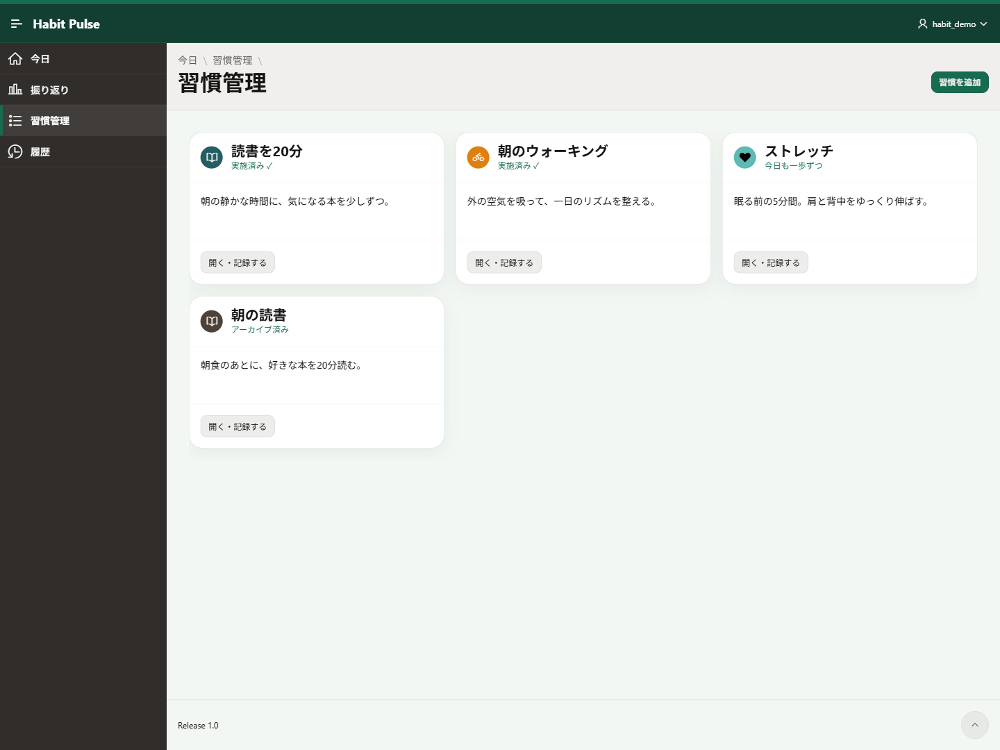

「履歴」には実施日、習慣名、メモを表示します。
実機では、アーカイブした習慣の1件と架空データ27件を合わせ、28件の表示を確認しました。
画面上部の検索や列見出し、Actionsメニューから、APEX標準のレポート機能で絞り込めます。

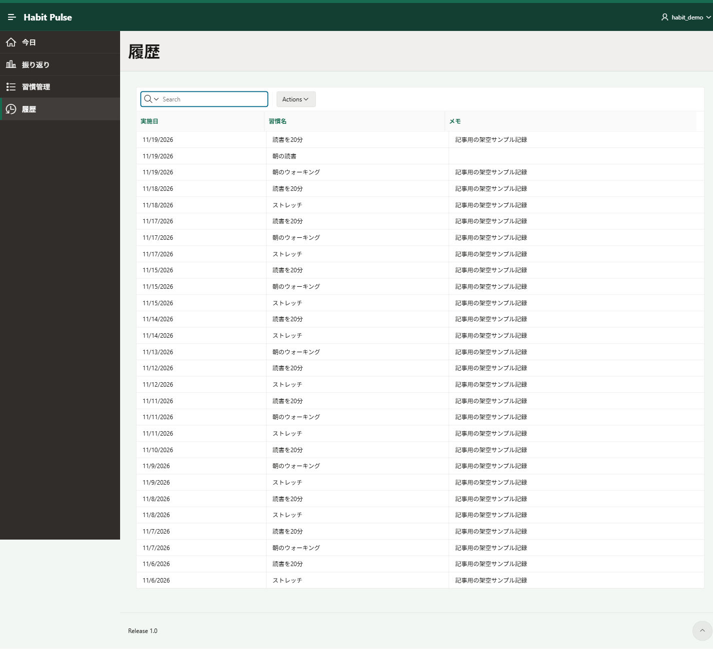

### スマートフォン幅で確認する

390px幅でも、カードが画面幅に収まり、横方向にはみ出さないことを確認しました。
これはブラウザーのスマートフォン幅での表示確認で、各機種の実機テストではありません。

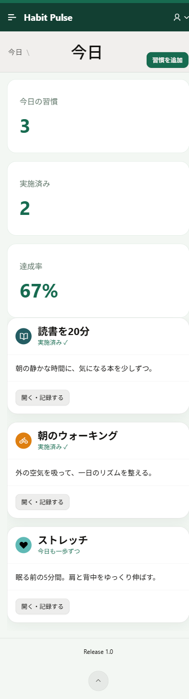

## 検証結果

### データベースAPIの確認

2026年11月19日に、実機のAPEX 26.1.6環境で次の8項目を確認し、すべてPASSとなりました。
初回の検証後、テーブルとAPIの配置先を解析スキーマへそろえ、Habit Pulseのアプリ110のセッションで同じ8項目のPASSを再確認しました。
API層の検証と、前節で示したブラウザーからの操作確認は分けて実施しています。
確認用スクリプトは[scripts/03_verify.sql](https://github.com/nomukyounomukyou-gh/qiita/blob/b0cd64b905fefcc95299b73489e028d4803d2cdb/articles/apexlang-habit-tracker/scripts/03_verify.sql)です。
ブラウザーを操作するUIテストとは別に、データベース側の更新処理と制約を確認しています。

APEXlangのインポートが完了し、検証対象のAPEXアプリが作成された後、スキーマへ接続したSQLclから次を実行します。
`<アプリID>`はインポート先の実際の数値へ置き換えます。

```text
sql -name habit-dev
```

```text
@scripts/03_verify.sql <アプリID>
```

このスクリプトは`APEX_SESSION.CREATE_SESSION`でテスト用セッションを作り、`HT_API`を呼び出します。
APEXのログイン用アカウントを新規作成する処理は含みません。
最後にテスト行をロールバックするため、習慣や実施記録は残りません。
SQLclで未確定の更新をしていない検証用接続から実行してください。

| 確認項目 | 実測結果 |
|---|---|
| 今日の日付がJSTの計算結果と一致 | PASS |
| セッション利用者から所有者を自動設定 | PASS |
| 同じ日の実施登録を繰り返しても1行 | PASS |
| 重複行を一意制約で拒否 | PASS |
| 別利用者による更新を拒否 | PASS |
| 取り消しを繰り返しても安全に終了 | PASS |
| アーカイブ後も実施履歴を保持 | PASS |
| アーカイブ後の実施登録を拒否 | PASS |

正常終了すると、8行の`PASS:`と、最後に次のメッセージが表示されます。

```text
ALL API CHECKS PASSED; test rows rolled back
```

APIの確認では、所有者分離、重複防止、取消、履歴保持という想定条件を満たしました。
この結果は、ブラウザーからの不正操作や画面側の一覧・集計がすべて正しいことまで保証するものではありません。
それらは画面の動作確認で別途確認します。

### 画面の確認

同日に、専用デモユーザーで次の操作を確認しました。

| 確認項目 | 想定する結果 | 実測結果 |
|---|---|---|
| 習慣登録 | 一覧に追加される | 保存後のカードを確認 |
| 必須入力 | 空の習慣名で保存しない | 画面・項目近くのエラー表示を確認 |
| 実施記録 | 達成数が増える | 1件中1件、100%を確認 |
| 再読み込み | 記録が保持される | 実施済み状態の保持を確認 |
| 取り消し | 記録と集計に反映される | 実施0件、0%を確認 |
| アーカイブ | 今日の対象から外れる | 今日から除外、履歴は保持 |
| 架空データ | 3現役習慣の表示 | 2件実施、67%を確認 |
| グラフ集計 | 日次SQLと折れ線の一致 | 直近7日間すべて一致 |
| 履歴 | 保存した実施記録を表示 | アーカイブ分を含む28件 |
| スマートフォン幅 | 横にはみ出さない | 390px幅で確認 |

同日の再送と別利用者の更新拒否はAPIテストで確認しています。
別利用者でのブラウザー操作による参照拒否は、今回のUI確認の範囲には含めていません。
グラフとSQLの照合手順は次のスクリプトで確認できます。

```text
@scripts/04_check_metrics.sql HABIT_DEMO
```

`PLANNED_HABITS`が分母、`COMPLETED_HABITS`が分子、`COMPLETION_PCT`が小数第1位までの達成率です。
2026年11月19日に、この読み取り専用SQLと実画面を照合しました。
期間中の対象習慣は毎日3件で、次の結果がグラフと一致しました。

| 日付（JST） | 対象習慣 | 実施数 | 達成率（%） |
|---|---:|---:|---:|
| 2026-11-13 | 3 | 1 | 33.3 |
| 2026-11-14 | 3 | 2 | 66.7 |
| 2026-11-15 | 3 | 3 | 100.0 |
| 2026-11-16 | 3 | 0 | 0.0 |
| 2026-11-17 | 3 | 3 | 100.0 |
| 2026-11-18 | 3 | 2 | 66.7 |
| 2026-11-19 | 3 | 2 | 66.7 |

11月16日は未実施、11月15日と17日はすべて実施した日として読み取れます。
ただし、これはグラフ確認用の架空データであり、実際の利用者の行動や傾向を分析した結果ではありません。

## 考察

APEXlangの取り込み成功だけでは、画面が使えることの確認にはなりませんでした。
今回、DDLを作成したスキーマとアプリの解析スキーマが異なり、APIテストが通っても画面側でオブジェクトを参照できない問題がありました。
接続ユーザー、オブジェクト所有者、Parsing Schemaをそろえ、アプリ110のセッションと実画面で再確認しました。

また、スキルに同梱されたひな形と実機のAPEXlangコンパイラで、属性名などに差がありました。
実機の`apex validate`が返すファイル名・行番号を使って修正し、警告のない検証成功後に取り込みました。
互換性調整の詳細は[implementation-notes.md](https://github.com/nomukyounomukyou-gh/qiita/blob/b0cd64b905fefcc95299b73489e028d4803d2cdb/articles/apexlang-habit-tracker/implementation-notes.md)に記録しています。

画面定義はAPEXlang、データ制約と更新処理はSQL／PL/SQL、配色や余白はCSSで担当させています。
連続日数などの未実装機能は、基本の登録・保存・集計の動作を確認したうえで追加する改善対象です。
UIの参考にしたのは[APEXlangでVibe Coding：画面デザイン集](https://qiita.com/araidon/items/d38d616dce3b3e3109c0)です。
本アプリでは、日々のチェック操作と達成状況が読み取りやすい配色・余白を選びます。

## 検証後の片付け

検証後、撮影用の4習慣・28実施記録、デモユーザー、関連するテストセッション10件を削除しました。
デモユーザーと対象データが0件であることを確認し、一時資格情報、サーバー上の一時ファイル、誤ったスキーマへ作成した空の中間オブジェクトも削除しました。
作業サーバーとADBは、OCI上で両方ともStoppedになったことを確認しています。
アプリ本体と解析スキーマのオブジェクト、APEXlangやSQL、記事、スクリーンショットは保持しています。
再びアプリを動かす場合は、ADBを起動して利用者を用意してください。

読者の環境では、次の順序で確認してください。

1. 必要なアプリ・ソースと保存データを退避します。
2. APEX管理画面のユーザー管理から、今回だけ作成したデモ用End Userを削除します。
3. デモデータを残さない場合は、専用ユーザーの記録を削除します。
4. 端末やサーバーに一時配置したWallet・資格情報を、運用方針に従って削除します。
5. 専用の作業サーバーを使った場合は停止します。
6. ADBの他の利用者に影響がないことを確認して停止します。

APEXユーザーの削除だけではHT_HABITとHT_CHECKINの行は削除されません。
共有環境の場合は、他のアプリや利用者のデータを削除しないよう、対象を確認してから操作してください。

専用デモ利用者のデータを削除する場合は、[scripts/05_cleanup_demo.sql](https://github.com/nomukyounomukyou-gh/qiita/blob/b0cd64b905fefcc95299b73489e028d4803d2cdb/articles/apexlang-habit-tracker/scripts/05_cleanup_demo.sql)を用意しています。
今回の片付けでも、このスクリプトのPREVIEWとDELETEを実行し、実施記録28件、習慣4件の削除と残件数0を確認しました。
スクリプトは指定した所有者のすべての習慣・実施記録を削除するため、実際の記録が混在するユーザー名は指定しないでください。

1. `sql -name habit-dev`で、テーブルを所有する解析スキーマへ接続します。
2. 記事用ディレクトリで、第2引数に`PREVIEW`を指定して実行します。
3. 表示された習慣名・開始日・アーカイブ日が、削除したいデモ利用者のデータだけであることを確認します。
4. 削除する場合だけ、第2引数を`DELETE`に変更して再実行します。
5. 実施記録、習慣の順に削除され、削除件数が表示されます。
6. APEX管理画面の「Manage Users and Groups」で専用デモ利用者を選び、削除します。

```text
@scripts/05_cleanup_demo.sql HABIT_DEMO PREVIEW
@scripts/05_cleanup_demo.sql HABIT_DEMO DELETE
```

第2引数が`DELETE`以外の場合は対象の一覧を表示するだけで、削除しません。
このスクリプトはデータだけを対象とし、APEXログインユーザーやアプリ本体、テーブル、APIは削除しません。

## 参考資料

- [Oracle APEX AI Application Generator / APEXlangの導入](https://www.oracle.com/apex/ai-application-generator/)
- [SQLcl 26.1のAPEXlangコマンド](https://docs.oracle.com/en/database/oracle/sql-developer-command-line/26.1/sqcug/apexlang.html)
- [Oracle公開のAPEXlangスキル](https://github.com/oracle/skills/tree/main/apex/apexlang)
- [ADBでAPEXワークスペースを作成する](https://docs.oracle.com/en-us/iaas/autonomous-database-serverless/doc/apex-create-workspace.html)
